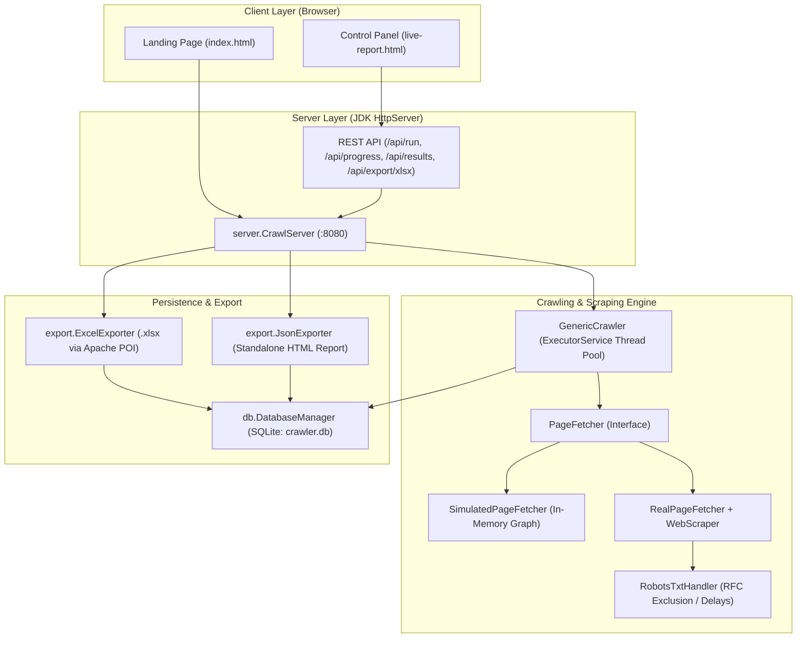

# Multithreaded Web Crawler & Graph Analytics Engine

A production-grade, pure-Java distributed crawling and web graph analysis platform. This project provides both a **simulated synthetic internet** (for deterministic concurrency benchmarking and graph theory analysis) and a **real-world ethical HTTP web scraper** (with RFC-compliant `robots.txt` parsing and politeness controls). 

All crawl runs are persisted to an embedded **SQLite** database via JDBC, streamed in real time via an embedded **JDK HTTP server**, visualized live on an interactive **browser control panel**, and exportable as styled **Excel spreadsheets (.xlsx)** and self-contained **HTML reports**.

---

## Table of Contents

- [Overview & Key Capabilities](#overview--key-capabilities)
- [System Architecture](#system-architecture)
- [Project Directory Structure](#project-directory-structure)
- [Prerequisites & Dependencies](#prerequisites--dependencies)
- [Quick Start Guide (Step-by-Step)](#quick-start-guide-step-by-step)
  - [Method 1: Build & Run with Apache Maven (Recommended)](#method-1-build--run-with-apache-maven-recommended)
  - [Method 2: Compile & Run with Standard JDK CLI](#method-2-compile--run-with-standard-jdk-cli)
- [Accessing the Interfaces & API Reference](#accessing-the-interfaces--api-reference)
  - [Web Interfaces](#web-interfaces)
  - [HTTP REST Endpoints](#http-rest-endpoints)
- [Core Engineering Concepts (Viva & Technical Deep-Dive)](#core-engineering-concepts-viva--technical-deep-dive)
  - [1. Concurrency Model & Race Condition Prevention](#1-concurrency-model--race-condition-prevention)
  - [2. Reliable Worker Termination Detection](#2-reliable-worker-termination-detection)
  - [3. Graph Traversal & Cycle Handling (BFS)](#3-graph-traversal--cycle-handling-bfs)
  - [4. Ethical Real-Web Scraping & robots.txt Compliance](#4-ethical-real-web-scraping--robotstxt-compliance)
  - [5. Database Schema & Automatic Migrations](#5-database-schema--automatic-migrations)
  - [6. High-Performance Reporting & Excel Export](#6-high-performance-reporting--excel-export)
- [Command-Line Utilities & Tests](#command-line-utilities--tests)
- [Cloud Deployment (Render / Docker)](#cloud-deployment-render--docker)
- [License & Acknowledgments](#license--acknowledgments)

---

## Overview & Key Capabilities

1. **Dual Crawling Modes**:
   - **Simulated Synthetic Graph**: Generates in-memory graphs with configurable nodes, link density, cycles, and simulated network latency. Perfect for reproducible multithreaded benchmarking without internet dependency.
   - **Real-World Web Scraper**: Live HTTP/HTTPS crawling using Java 11+ `java.net.http.HttpClient` with configurable politeness delays, domain-boundary locking (stays on the target host), and clean paragraph excerpt extraction.
2. **True Multithreaded Execution**:
   - Fixed thread pool architecture (`ExecutorService`) where worker threads continuously discover and consume new URLs dynamically.
   - Demonstrates a **3x–8x performance speedup** over single-threaded BFS when overlapping I/O wait times.
3. **Zero External Web Framework Overhead**:
   - The embedded HTTP server uses the JDK's built-in `com.sun.net.httpserver.HttpServer`. No heavy external runtime (e.g. Tomcat, Spring Boot) is needed, keeping memory usage minimal.
4. **Automated Persistence & Schema Management**:
   - Zero-configuration embedded **SQLite** backend with automated table creation and non-destructive schema migrations.
5. **Real-Time Visualizer & Dashboard**:
   - Web-based control dashboard featuring dynamic canvas-based graph rendering, thread color-coding, real-time activity log streams, and comparative speedup charts.
6. **Multi-Format Export Engine**:
   - Generates multi-column, formatted Microsoft Excel workbooks (`.xlsx`) via **Apache POI**, as well as standalone, portable HTML reports with embedded JSON datasets.

---

## System Architecture



---

## Project Directory Structure

```
WEB-CRAWLER/
├── pom.xml                               # Maven project descriptor & build configuration
├── render.yaml                           # Cloud deployment blueprint (e.g., Render)
├── index.html                            # Landing page & overview interface
├── sqlite-jdbc-3.53.4.0.jar              # Bundled SQLite JDBC driver jar for CLI execution
│
├── crawler/                              # Core crawling engine implementations
│   ├── PageFetcher.java                  # Unified abstraction for page fetching
│   ├── SimulatedPageFetcher.java         # Fetcher querying the in-memory WebGraph
│   ├── RealPageFetcher.java              # Fetcher querying live HTTP endpoints
│   ├── GenericCrawler.java               # Flagship configurable crawler (single & multi-threaded)
│   ├── ProgressListener.java             # Callback listener interface for real-time progress events
│   ├── ComparisonRunner.java             # Standalone CLI benchmark (Single vs. Multi-thread)
│   ├── SingleThreadedCrawler.java        # Standalone reference single-threaded BFS crawler
│   ├── MultiThreadedCrawler.java         # Standalone reference multi-threaded crawler
│   ├── RealSingleThreadedCrawler.java    # Standalone reference real-web single-thread crawler
│   └── RealMultiThreadedCrawler.java     # Standalone reference real-web multi-thread crawler
│
├── Graph/                                # In-memory graph data structures
│   ├── Page.java                         # Graph node model (Page ID, title, outbound links)
│   └── WebGraph.java                     # Graph generator (test graph with cycles & random graphs)
│
├── scraper/                              # Live web extraction & network etiquette
│   ├── WebScraper.java                   # HTTP client, link extractor, & paragraph parser
│   └── RobotsTxtHandler.java             # robots.txt discovery, parser, and URL rule validator
│
├── db/                                   # Data persistence layer
│   └── DatabaseManager.java              # JDBC SQLite manager, connection pool & migrations
│
├── export/                               # Data export and reporting
│   ├── ExcelExporter.java                # Apache POI spreadsheet generator (.xlsx)
│   └── JsonExporter.java                 # Generates standalone report HTML with baked JSON
│
├── server/                               # Embedded web server & API
│   └── CrawlServer.java                  # JDK HttpServer router, event broker & static file host
│
├── report/                               # Web templates & generated export artifacts
│   ├── live-report.html                  # Interactive live crawling visualizer & control panel
│   ├── report.html                       # HTML report template
│   └── crawl-report.html                 # Baked offline HTML report (generated by JsonExporter)
│
└── tests/                                # Test suites
    └── ExcelExportSmokeTest.java         # Verification test for Excel workbook generation
```

---

## Prerequisites & Dependencies

- **Java Development Kit (JDK)**: Version 17 or higher recommended (Minimum JDK 11 required for `java.net.http.HttpClient`).
- **Apache Maven**: Version 3.8+ (Optional if using the bundled `.jar` for CLI execution).
- **Core Libraries**:
  - `org.xerial:sqlite-jdbc:3.53.4.0` — SQLite JDBC Driver.
  - `org.apache.poi:poi-ooxml:5.3.0` — OpenXML Excel spreadsheet generator.

---

## Quick Start Guide (Step-by-Step)

### Method 1: Compile & Run with Standard Java (Zero Setup - Recommended)

Since all required libraries (`sqlite-jdbc` and `Apache POI`) are already bundled in the repository inside `lib/` and the root folder, **you do not need Maven installed**.

#### On Windows (PowerShell / Command Prompt):
```powershell
# 1. Compile all packages
javac -cp ".;sqlite-jdbc-3.53.4.0.jar;lib/*" Graph/*.java db/*.java crawler/*.java scraper/*.java export/*.java server/*.java tests/*.java

# 2. Launch the server
java -cp ".;sqlite-jdbc-3.53.4.0.jar;lib/*" server.CrawlServer
```

#### On Linux / macOS (Bash):
```bash
# 1. Compile all packages
javac -cp ".:sqlite-jdbc-3.53.4.0.jar:lib/*" Graph/*.java db/*.java crawler/*.java scraper/*.java export/*.java server/*.java tests/*.java

# 2. Launch the server
java -cp ".:sqlite-jdbc-3.53.4.0.jar:lib/*" server.CrawlServer
```

---

### Method 2: Build & Run with Apache Maven (Optional)

If you have Apache Maven installed (`mvn -version`):

1. **Package the executable Uber-JAR (includes dependencies)**:
   ```bash
   mvn clean package
   ```
   *This compiles all source files and produces `target/web-crawler-1.0.0-jar-with-dependencies.jar`.*

2. **Launch the server**:
   ```bash
   java -jar target/web-crawler-1.0.0-jar-with-dependencies.jar
   ```

> [!NOTE]
> If you get `'mvn' is not recognized`, simply use **Method 1** above! Alternatively, install Maven on Windows via PowerShell:
> ```powershell
> winget install Apache.Maven
> ```
> *(Restart your terminal after installation)*

---

## Accessing the Interfaces & API Reference

Once the server outputs `CrawlServer running at http://localhost:8080`, open your web browser:

### Web Interfaces

| Page | URL | Description |
| :--- | :--- | :--- |
| **Landing Page** | `http://localhost:8080/` | Visual overview, project feature breakdown, and quick launch links. |
| **Control Dashboard** | `http://localhost:8080/dashboard` or `/live-report.html` | Real-time crawl launcher, visual graph canvas, live event log, and speedup charts. |

---

### HTTP REST Endpoints

#### 1. Start Crawl: `POST /api/run`
Triggers an asynchronous crawl in the background.

**Query Parameters:**
- `source`: `simulated` (default) or `real`.
- `pages`: Maximum page limit (default `300` for simulated, capped at `60` for real).
- `threads`: Number of concurrent worker threads (e.g. `1` to `16`, default `8`).
- `depth`: Maximum link traversal depth (default `8`).
- `latency`: Artificial simulated delay in milliseconds (default `20` ms for simulated; min `150` ms politeness for real).
- `seedUrl`: Seed URL required when `source=real` (e.g., `https://en.wikipedia.org/wiki/Web_crawler`).

**Example Request:**
```http
POST /api/run?source=real&seedUrl=https%3A%2F%2Fen.wikipedia.org%2Fwiki%2FWeb_crawler&threads=4&depth=3&pages=20
```

#### 2. Poll Live Progress: `GET /api/progress?since={sequenceNumber}`
Returns JSON stream of crawl events occurred since the given sequence index.

**Sample Response:**
```json
{
  "running": true,
  "latestSeq": 14,
  "events": [
    {
      "seq": 14,
      "mode": "multi",
      "page": "https://en.wikipedia.org/wiki/Web_crawler",
      "thread": "pool-1-thread-2",
      "depth": 0,
      "elapsedMs": 312,
      "links": ["https://en.wikipedia.org/wiki/Search_engine", "..."]
    }
  ]
}
```

#### 3. Fetch Latest Results: `GET /api/results`
Returns complete graph structure, run summary, performance metrics, and visit logs from SQLite.

#### 4. Download Excel Report: `GET /api/export/xlsx`
Generates and downloads a `.xlsx` spreadsheet of the latest crawl run.

---

## Core Engineering Concepts (Viva & Technical Deep-Dive)

### 1. Concurrency Model & Race Condition Prevention
In a multi-threaded crawler, multiple worker threads discover URLs simultaneously and may attempt to crawl the exact same URL concurrently.
- **Naïve Approach (Flawed)**: Checking `if (!visited.contains(url)) { visited.add(url); submitTask(url); }` creates a race condition (check-then-act) between concurrent threads.
- **Solution in this Project**:
  ```java
  private final Set<String> visited = ConcurrentHashMap.newKeySet();
  
  private void submitTask(String pageId, int depth) {
      if (!visited.add(pageId)) {
          return; // Atomic check-and-mark in one indivisible operation!
      }
      pendingTasks.incrementAndGet();
      pool.submit(() -> processPage(pageId, depth));
  }
  ```
  `ConcurrentHashMap.newKeySet().add()` performs an atomic check-and-insert backed by compare-and-swap (CAS) operations. If two threads hit the same URL at the same millisecond, exactly one succeeds and queues the work.

### 2. Reliable Worker Termination Detection
A multithreaded crawler cannot simply stop when its `ExecutorService` queue is empty, because active threads may still be parsing links and about to submit new tasks.
- **Solution**: We maintain an `AtomicInteger pendingTasks` counter:
  - Increment when a task is submitted (`pendingTasks.incrementAndGet()`).
  - Decrement in a `finally` block after processing completes (`pendingTasks.decrementAndGet()`).
  - Only when `pendingTasks` reaches `0` do we signal completion via `doneLock.notifyAll()`.

### 3. Graph Traversal & Cycle Handling (BFS)
- The crawler executes **Breadth-First Search (BFS)** traversal, exploring all neighbors at `depth N` before traversing deeper into `depth N + 1`.
- Graph cycles (e.g., `Page A -> Page B -> Page C -> Page A`) are handled cleanly by the atomic visited set, preventing infinite loops.
- `threadCount = 1` behaves as a strict FIFO BFS crawl, providing a baseline to calculate multi-threaded speedup:
  $$\text{Speedup} = \frac{\text{Time}_{\text{Single-Threaded}}}{\text{Time}_{\text{Multi-Threaded}}}$$

### 4. Ethical Real-Web Scraping & robots.txt Compliance
The `scraper/` package implements respectful crawling mechanisms:
- **`RobotsTxtHandler`**: Fetches and parses `/robots.txt` from the origin host, caching rules in-memory. Evaluates `User-agent`, `Disallow`, `Allow`, and custom `Crawl-delay` directives before any HTTP request is dispatched.
- **Domain Confinement**: Extracts hyperlinks and resolves relative paths (`/path`) against the base URI, strictly discarding links pointing outside the seed domain.
- **Clean Content Extraction**: Uses regular expressions to extract `<title>`, filter non-HTML assets (PDFs, images, anchors, mailto links), and extract clean paragraph excerpts (`<p>` tags $\ge$ 40 characters).
- **Polite Rate Limiting**: Enforces a minimum delay between subsequent requests to avoid overloading web servers.

### 5. Database Schema & Multi-Database Engine (MySQL / phpMyAdmin + SQLite)
The crawler provides native support for **MySQL (XAMPP / phpMyAdmin)** with automatic fallback to embedded **SQLite**:

#### XAMPP MySQL / phpMyAdmin Integration:
1. Open your **XAMPP Control Panel** and click **Start** next to **MySQL** (and **Apache** if you want web phpMyAdmin access).
2. The project's [`DatabaseManager.java`](file:///c:/Users/jangamswarali/Downloads/proJECT/proJECT/db/DatabaseManager.java) will:
   - Automatically connect to `localhost:3306` with user `root` (default XAMPP credentials).
   - Automatically create the database `crawler_db` if it doesn't already exist.
   - Automatically create the 4 tables (`pages`, `links`, `crawl_runs`, `crawl_log`).
3. You can inspect all data visually in phpMyAdmin by browsing to:
   `http://localhost/phpmyadmin` -> Click on database **`crawler_db`**.

#### Configuration (`db.properties`):
You can customize database connection parameters in [`db.properties`](file:///c:/Users/jangamswarali/Downloads/proJECT/proJECT/db.properties):
```properties
db.type=mysql
mysql.host=localhost
mysql.port=3306
mysql.database=crawler_db
mysql.username=root
mysql.password=

sqlite.path=data/crawler.db
```

#### SQL Schema (`schema.sql`):
```sql
CREATE DATABASE IF NOT EXISTS crawler_db CHARACTER SET utf8mb4 COLLATE utf8mb4_unicode_ci;
USE crawler_db;

CREATE TABLE IF NOT EXISTS pages (
    page_id VARCHAR(255) NOT NULL,
    title VARCHAR(500),
    excerpt TEXT,
    url TEXT,
    created_at TIMESTAMP DEFAULT CURRENT_TIMESTAMP,
    PRIMARY KEY (page_id)
) ENGINE=InnoDB DEFAULT CHARSET=utf8mb4;

CREATE TABLE IF NOT EXISTS links (
    id INT AUTO_INCREMENT PRIMARY KEY,
    from_page VARCHAR(255) NOT NULL,
    to_page VARCHAR(255) NOT NULL,
    created_at TIMESTAMP DEFAULT CURRENT_TIMESTAMP,
    INDEX idx_from_page (from_page),
    INDEX idx_to_page (to_page),
    UNIQUE KEY uq_link (from_page(191), to_page(191))
) ENGINE=InnoDB DEFAULT CHARSET=utf8mb4;

CREATE TABLE IF NOT EXISTS crawl_runs (
    run_id INT AUTO_INCREMENT PRIMARY KEY,
    mode VARCHAR(50),
    thread_count INT,
    total_time_ms INT,
    pages_visited INT,
    run_at TIMESTAMP DEFAULT CURRENT_TIMESTAMP
) ENGINE=InnoDB DEFAULT CHARSET=utf8mb4;

CREATE TABLE IF NOT EXISTS crawl_log (
    id INT AUTO_INCREMENT PRIMARY KEY,
    run_id INT NOT NULL,
    page_id VARCHAR(255) NOT NULL,
    thread_name VARCHAR(100),
    depth INT,
    elapsed_ms BIGINT,
    status_code INT,
    discovered_links MEDIUMTEXT,
    page_url TEXT,
    visited_at TIMESTAMP DEFAULT CURRENT_TIMESTAMP,
    INDEX idx_run_id (run_id),
    INDEX idx_page_id (page_id)
) ENGINE=InnoDB DEFAULT CHARSET=utf8mb4;
```
- **Automatic Fallback Safety**: If MySQL in XAMPP is not started, the application alerts you with a notice in the console and automatically falls back to SQLite so runs never crash.
- **Thread-Safe Writes**: Database write operations use `synchronized` methods to implement a single-writer pattern, preventing table locking conflicts under concurrency.

### 6. High-Performance Reporting & Excel Export
- **Apache POI Excel Export**: `ExcelExporter.java` queries `crawl_log` and `pages` to build a `.xlsx` spreadsheet with styled headers, status codes, fetch durations, link counts, and auto-adjusted column widths.
- **Standalone Portable HTML Report**: `JsonExporter.java` bakes the raw database JSON directly into `report/crawl-report.html`. This ensures the report can be opened locally via the `file://` protocol without encountering browser CORS restrictions.

---

## Command-Line Utilities & Tests

Run individual benchmark components or smoke tests directly:

### 1. Run Headless Single vs. Multi-Thread Benchmark
Compares single-threaded vs. 8-threaded crawling across a 300-node graph:
```bash
# Using Maven compiled classes:
java -cp "target/classes;sqlite-jdbc-3.53.4.0.jar" crawler.ComparisonRunner

# Or using plain classpath:
java -cp ".;sqlite-jdbc-3.53.4.0.jar" crawler.ComparisonRunner
```

### 2. Generate Standalone HTML Report from SQLite
```bash
java -cp ".;sqlite-jdbc-3.53.4.0.jar" export.JsonExporter
# Creates report/crawl-report.html
```

### 3. Run Excel Export Smoke Test
```bash
java -cp "target/classes;target/dependency/*;sqlite-jdbc-3.53.4.0.jar" tests.ExcelExportSmokeTest
```

---

## Cloud Deployment (Render / Docker)

The repository includes a ready-to-use `render.yaml` configuration for automated deployment on [Render](https://render.com) or similar cloud PaaS providers:

```yaml
services:
  - type: web
    name: web-crawler
    runtime: java
    plan: free
    buildCommand: mvn clean package
    startCommand: java -jar target/web-crawler-1.0.0-jar-with-dependencies.jar
    envVars:
      - key: PORT
        value: 10000
      - key: DB_PATH
        value: data/crawler.db
```

### Environment Variables
- `PORT`: Server port (Defaults to `8080` locally, or auto-assigned by host provider).
- `DB_PATH`: Filesystem path for the SQLite database file (Defaults to `data/crawler.db`). Parent directories are automatically provisioned.

---

## License & Acknowledgments

- Built with modern Java standard libraries.
- Uses [SQLite JDBC](https://github.com/xerial/sqlite-jdbc) by Xerial and [Apache POI](https://poi.apache.org/) for Excel generation.